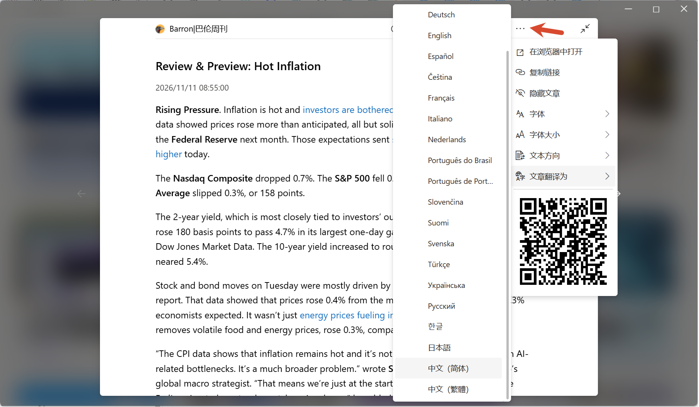

<p align="center">
  <a href="README.md">English</a> | <strong>简体中文</strong>
</p>

<p align="center">
  
</p>
<h3 align="center">Fluent Reader</h3>
<p align="center">一款现代化的桌面 RSS 阅读器</p>
<p align="center">
  
  
  
</p>
<hr />

## 下载

Windows 10 用户推荐通过 [Microsoft Store](https://www.microsoft.com/store/apps/9P71FC94LRH8?cid=github) 安装，
这样可以获得自动更新和实验性的 ARM64 支持。
macOS 用户也可以从 [Mac App Store](https://apps.apple.com/app/id6761698838) 获取 Fluent Reader。

如果你使用 Linux 或较旧版本的 Windows，可以从 [GitHub Releases](https://github.com/yang991178/fluent-reader/releases) 下载 Fluent Reader。

### 移动端

移动版应用的仓库[可以在这里找到](https://github.com/yang991178/fluent-reader-lite)。

## 功能

<p align="center">
  
</p>
<p align="center">
  
</p>

- 受 Fluent Design System 启发的现代界面，完整支持深色模式。
- 可本地阅读，或与兼容 Fever / Google Reader API 的自托管服务同步。
- 支持 Inoreader、Feedbin、The Old Reader、BazQux Reader 等 RSS 服务。
- 支持导入/导出 OPML，以及完整应用数据的备份与恢复。
- 使用内置文章视图阅读全文，或默认加载网页。
- 使用 Google 翻译翻译卡片标题、摘要和整篇文章；可在工具栏或文章菜单中选择目标语言。
- 支持正则表达式搜索文章，或按已读状态筛选。
- 使用类似文件夹的分组整理订阅源。
- 单键[键盘快捷键](https://github.com/yang991178/fluent-reader/wiki/Support#keyboard-shortcuts)。
- 通过正则规则在新文章到达时自动隐藏、标为已读或收藏。
- 后台获取文章并发送推送通知。

> 卡片和文章翻译使用 Google 翻译，需要能够访问 `translate.googleapis.com`。

其他 RSS 服务的支持正在[众筹中](https://github.com/yang991178/fluent-reader/issues/23)。

## 开发

### 参与贡献

欢迎通过 [GitHub Issues](https://github.com/yang991178/fluent-reader/issues) 报告问题或提出功能建议。

你也可以通过提供[更多语言的翻译](https://github.com/yang991178/fluent-reader/tree/master/src/scripts/i18n)帮助应用国际化。
有关国际化的入门方法，请参考 [react-intl-universal](https://github.com/alibaba/react-intl-universal) 的仓库。

如果你喜欢使用这个应用，可以通过 [GitHub Sponsors](https://github.com/sponsors/yang991178)、
[Paypal](https://www.paypal.me/yang991178) 或 [支付宝](https://hyliu.me/fluent-reader/imgs/alipay.jpg) 支持它的开发。

### 从源码构建
```bash
# 安装依赖
npm install

# 编译 TypeScript 和依赖
npm run build

# 启动应用
npm run electron

# 生成签名证书
electron-builder create-self-signed-cert
# 打包 Windows 应用
npm run package-win

```

### 技术栈

- [Electron](https://github.com/electron/electron)
- [React](https://github.com/facebook/react)
- [Redux](https://github.com/reduxjs/redux)
- [Fluent UI](https://github.com/microsoft/fluentui)
- [Lovefield](https://github.com/google/lovefield)
- [Mercury Parser](https://github.com/jocmp/mercury-parser)

### 许可证

BSD
